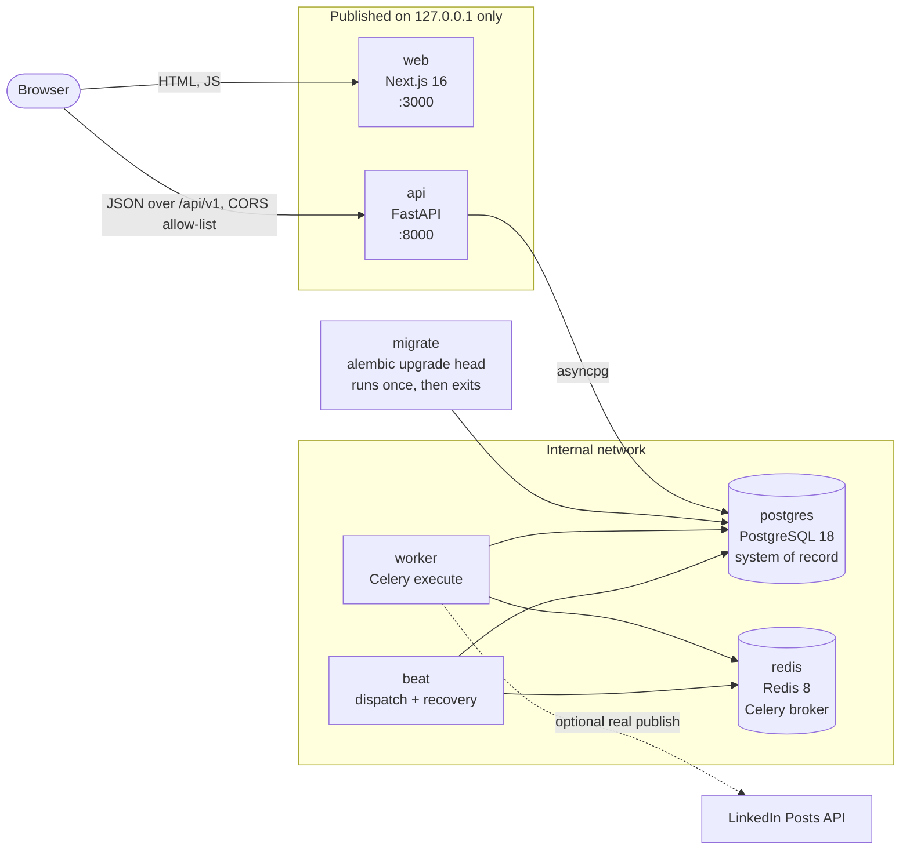

# PostPilot AI

A LinkedIn post scheduling application. The **user-facing workflow is real LinkedIn text
publishing** (OAuth, scheduling, Celery workers, canary-gated live Posts API). The fake
publisher remains for automated tests and explicit simulation only; it is not a fallback
when LinkedIn fails. AI generation and media uploads are not implemented.

See [docs/implementation-status.md](docs/implementation-status.md) for exactly what is
and is not built, [docs/publishing-engine.md](docs/publishing-engine.md) for the worker
architecture, [docs/linkedin-publishing.md](docs/linkedin-publishing.md) for real LinkedIn
publishing, [docs/live-e2e-publishing.md](docs/live-e2e-publishing.md) for the canary
live E2E checklist, [docs/scheduled-posts.md](docs/scheduled-posts.md) for the scheduling API,
[docs/linkedin-oauth.md](docs/linkedin-oauth.md) for OAuth setup, and
[docs/decisions/0001-architecture.md](docs/decisions/0001-architecture.md) for the
reasoning behind the stack.

## Architecture



- **web** (`apps/web`) is a Next.js App Router application. The browser calls the API
  directly; the API origin comes from `NEXT_PUBLIC_API_BASE_URL`.
- **api** (`apps/api`) is a FastAPI application. Every route lives under `/api/v1`.
  Routes are thin; logic lives in `app/services`.
- **postgres** is the single source of truth for all durable state.
- **redis** is the Celery broker. Queue messages are rebuildable from PostgreSQL leases.
- **worker** / **beat** run Celery execute and periodic dispatch/recovery tasks.
- **migrate** applies Alembic migrations before the API starts.
- Real LinkedIn publishing stays off until `PUBLISH_PROVIDER=linkedin` and
  `ENABLE_REAL_PUBLISHING=true` (see [docs/linkedin-publishing.md](docs/linkedin-publishing.md)).

### Repository layout

```text
apps/
  web/                  Next.js frontend (pnpm)
    src/app/            Routes and layout
    src/components/     layout/, dashboard/, ui/ (shadcn/ui)
    src/lib/            env.ts, api/ (typed API client)
  api/                  FastAPI backend (uv)
    app/
      api/v1/           HTTP routes
      core/             config, logging, errors, middleware
      db/               SQLAlchemy base and engine/session factory
      models/           ORM models (users, sessions, LinkedIn, scheduled posts)
      schemas/          Pydantic request/response models
      services/         Business logic (OAuth, sessions, connections, posts)
      repositories/     Persistence helpers (posts)
      integrations/     LinkedIn OAuth/OIDC client
      workers/          Celery app + publish tasks
      publishing/       Fake and real LinkedIn publishers
    alembic/            Async migration environment
    tests/              Unit tests, plus tests/integration
infra/                  Optional Compose overrides
docs/                   Decisions and implementation status
docker-compose.yml      Local stack
.env.example            Documented configuration
```

## Prerequisites

To run the stack, you only need Docker:

| Tool | Version | Needed for |
| --- | --- | --- |
| Docker Engine with Compose v2 | Engine 24 or newer | Running the stack |

To develop or run checks on the host, you also need:

| Tool | Version | Needed for |
| --- | --- | --- |
| [uv](https://docs.astral.sh/uv/getting-started/installation/) | 0.13 or newer | Backend. uv downloads Python 3.14 itself. |
| Node.js | 22 or newer (24 used in Docker and CI) | Frontend |
| pnpm | 10 | Frontend. The exact version is pinned in `apps/web/package.json`. |

## Run the stack with Docker Compose

Run every command from the repository root.

**1. Create your environment file.**

```sh
cp .env.example .env
```

**2. Set required secrets in `.env`.** At minimum: `POSTGRES_PASSWORD`, `REDIS_PASSWORD`,
`TOKEN_ENCRYPTION_KEY`, and the LinkedIn OAuth values. Blank secrets refuse to start.
See [docs/linkedin-oauth.md](docs/linkedin-oauth.md) for the LinkedIn app setup.

```sh
# Hex secrets (Postgres / Redis)
uv run --no-project python -c "import secrets; print(secrets.token_hex(24))"

# AES-256 encryption key (base64-encoded 32 bytes)
uv run --no-project python -c "import base64,secrets; print(base64.b64encode(secrets.token_bytes(32)).decode())"
```

```powershell
# Hex secret with PowerShell only
$b = New-Object byte[] 24; [Security.Cryptography.RandomNumberGenerator]::Create().GetBytes($b); -join ($b | ForEach-Object { $_.ToString('x2') })
```

**3. Build and start.**

```sh
docker compose up -d --build --wait
```

`--wait` returns once every service reports healthy. The first build takes a few minutes.

**4. Check it.**

| What | URL |
| --- | --- |
| Web app | <http://localhost:3000> |
| LinkedIn connections | <http://localhost:3000/connections> |
| Scheduled posts | <http://localhost:3000/posts> |
| Celery worker / beat | Compose services `worker` and `beat` |
| API liveness | <http://localhost:8000/api/v1/health/live> |
| API readiness (checks PostgreSQL) | <http://localhost:8000/api/v1/health/ready> |
| Interactive API docs (disabled when `APP_ENV=production`) | <http://localhost:8000/api/v1/docs> |

```sh
curl http://localhost:8000/api/v1/health/live
# {"status":"alive"}

curl http://localhost:8000/api/v1/health/ready
# {"status":"ready","checks":{"database":"ok"}}
```

The dashboard's **System status** card calls the readiness endpoint from the browser, so
it also confirms that CORS is configured correctly.

**5. Stop.**

```sh
docker compose down        # stop and remove containers; database volume is kept
docker compose down -v     # also delete the database volume (destroys all data)
```

Other useful commands:

```sh
docker compose ps                 # service state and health
docker compose logs -f api        # structured JSON logs
docker compose up -d --build web  # rebuild after changing NEXT_PUBLIC_API_BASE_URL
```

Only the web app and the API are published, and only on `127.0.0.1`. PostgreSQL and
Redis have no published port and sit on a network with no route to the host.

## Develop on the host

Use this when you want hot reload, or to run tests and migrations directly.

### Backend

The base Compose file does not publish PostgreSQL. An override publishes it on
`127.0.0.1` only:

```sh
docker compose -f docker-compose.yml -f infra/docker-compose.host-dev.yml up -d --wait postgres
```

Then, from `apps/api`:

```sh
cd apps/api
uv sync --locked
uv run --env-file ../../.env alembic upgrade head
uv run --env-file ../../.env uvicorn app.main:create_app --factory --reload --port 8000
```

The API reads configuration from process environment variables only. It never opens a
`.env` file itself, which is why host commands pass `--env-file`. If the Compose `api`
container is already using port 8000, stop it first with `docker compose stop api`.

### Frontend

```sh
cd apps/web
pnpm install --frozen-lockfile
cp .env.example .env.local
pnpm dev
```

The app is served at <http://localhost:3000> and needs the API running on the origin set
in `.env.local`.

## Checks

Backend, from `apps/api`:

```sh
uv run ruff check .             # lint
uv run ruff format --check .    # formatting
uv run pytest                   # unit tests; no database or network needed
```

The unit tests cover health, OAuth/sessions, scheduled posts (idempotency, timezone,
concurrency conflicts), configuration, the error envelope, request IDs, CORS, and log
redaction.

Integration tests run against a real PostgreSQL. They are excluded by default and need
the host-dev override from the previous section:

```sh
uv run --env-file ../../.env pytest -m integration
```

Frontend, from `apps/web`:

```sh
pnpm lint         # ESLint, zero warnings allowed
pnpm typecheck    # generates route types, then tsc --noEmit (strict)
pnpm build        # production build
```

CI runs the same commands on every pull request and on pushes to `main`. See
[.github/workflows/ci.yml](.github/workflows/ci.yml).

## Configuration

Every variable is documented in [.env.example](.env.example). In summary:

| Variable | Required | Purpose |
| --- | --- | --- |
| `APP_ENV` | Yes | `local`, `test`, `staging`, or `production` |
| `LOG_LEVEL` | No (`INFO`) | Log threshold |
| `LOG_FORMAT` | No (`json`) | `json` or `console`. Compose containers always use `json`. |
| `CORS_ALLOWED_ORIGINS` | Yes | Comma-separated exact origins. Wildcards are rejected at startup. |
| `POSTGRES_DB`, `POSTGRES_USER` | Yes | Database name and role |
| `POSTGRES_PASSWORD` | Yes, secret | No default |
| `POSTGRES_HOST`, `POSTGRES_PORT` | Yes on the host | How a host process reaches PostgreSQL. Containers always use `postgres:5432`. |
| `REDIS_PASSWORD` | Yes, secret | No default. Used by the Redis container only. |
| `NEXT_PUBLIC_API_BASE_URL` | Yes | API origin as seen by the browser. Inlined at build time. |
| `API_PORT`, `WEB_PORT` | No (`8000`, `3000`) | Ports published on `127.0.0.1` |
| `LINKEDIN_*`, `TOKEN_ENCRYPTION_KEY`, `WEB_BASE_URL` | Yes for OAuth | LinkedIn app + AES key + post-OAuth redirect origin |
| `SCHEDULE_MIN_LEAD_SECONDS` | No (`60`) | Minimum delay before a post may be scheduled |
| `POST_CONTENT_MAX_LENGTH` | No (`3000`) | Max accepted post body length |
| `POSTS_PAGE_SIZE_DEFAULT` / `MAX` | No (`20` / `50`) | List pagination bounds |

If you change `WEB_PORT`, add the new origin to `CORS_ALLOWED_ORIGINS`. If you change
`API_PORT`, update `NEXT_PUBLIC_API_BASE_URL` and rebuild the web image.

## API conventions

- **Versioning:** every route is under `/api/v1`.
- **Errors:** every error response, including 404, 422, and 500, has the same shape.

  ```json
  {
    "error": {
      "code": "dependency_unavailable",
      "message": "PostgreSQL is not reachable.",
      "request_id": "1325f508b14a4e8cabfc1941f9d34a26",
      "details": []
    }
  }
  ```

- **Request IDs:** every response carries `X-Request-ID`. A well-formed ID sent by the
  client is kept; otherwise one is generated. The same ID appears on every log line for
  that request.
- **Logging:** structured, one event per line. Values under secret-looking keys,
  credentials inside URLs, bearer tokens, and secret query parameters are redacted before
  output. Query strings are never included in the request log.
- **Health:** `/health/live` touches no external service. `/health/ready` runs a real
  query against PostgreSQL and returns 503 when it fails or times out.
